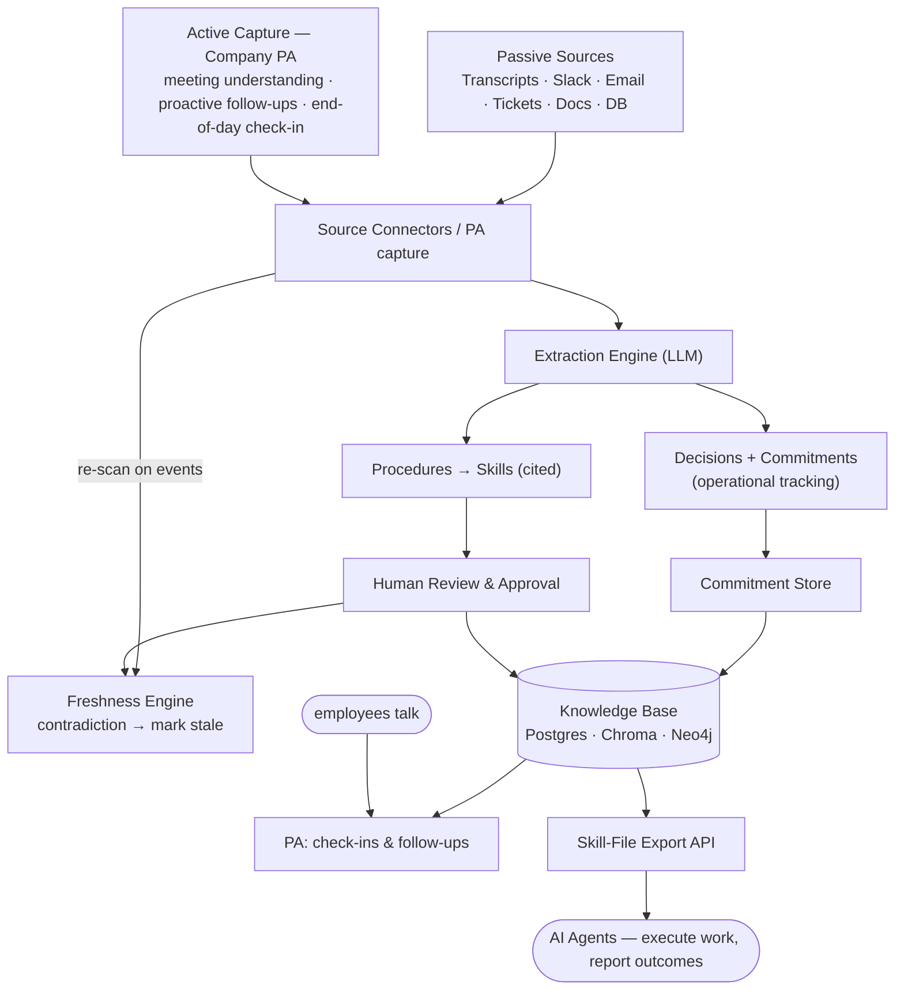

# Company Brain

**The executable knowledge layer for AI agents.** Company Brain pulls a company's operational know-how out of the fragmented places it lives — meetings, Slack, email threads, support tickets, docs, databases, and people's heads — structures it into **executable skills**, keeps those skills current, and serves them to AI agents so they can do real work safely and consistently.

It captures knowledge two ways: **passively** from the trail work already leaves (transcripts, Slack, email, tickets, docs, DBs), and **actively** through a personal **Company PA** for every employee — an assistant that understands their meetings, tracks the commitments made in them, and follows up in plain language, including a brief end-of-day conversation. No forms, no questionnaires.

It is **not** a company-wide search engine and **not** a chatbot over documents. Those answer questions for humans. Company Brain produces machine-consumable **skill files** whose primary consumer is an AI agent that executes work.

> A *skill* captures **how the company actually does something** — how refunds get handled, how pricing exceptions are decided, how engineers respond to an incident. Each skill has a trigger, steps, decision rules, guardrails, escalation, and citations back to the evidence it was synthesized from.

---

## 📖 Documentation

| Doc | Purpose |
|---|---|
| **[docs/USAGE.md](docs/USAGE.md)** | Setup, running (Docker or local dev), feature-by-feature procedures, troubleshooting |
| **[docs/ARCHITECTURE.md](docs/ARCHITECTURE.md)** | Codebase map — services, routes, models, jobs, "where to change X" |
| **[docs/CHANGELOG.md](docs/CHANGELOG.md)** | What changed and why |

New here? Read **[docs/ARCHITECTURE.md](docs/ARCHITECTURE.md)** first.

---

## Why this exists

The blocker to automating company work is no longer model capability — it's that the domain knowledge needed to *act* is scattered, undocumented, and locked in human memory. A RAG chatbot retrieves text for a human to interpret. An agent needs the **procedure**, made explicit, current, and executable. Company Brain is the missing layer between raw company data and reliable AI automation.

---

## Architecture



### Capture loop (Company PA)

```
1. A meeting transcript is ingested → decisions + commitments extracted (with owners)
2. The PA follows up on due/stale commitments in natural language (no forms)
3. At end of day the employee just talks to their PA about what they did
4. The PA turns the conversation into structured updates + new fragments
```

### Skill loop (agent enablement)

```
5. Extraction synthesizes candidate procedures from fragments, each step cited
6. A human reviews, edits, and approves each skill
7. Approved skills are exported as agent-consumable skill files via API
8. Agents fetch skills and execute work within declared guardrails
9. Outcomes + new evidence feed the freshness engine; stale skills are re-proposed
```

---

## The skill object

Every skill is a structured, executable procedure:

| Field | Purpose |
|---|---|
| `name` / `description` | Identity and when-to-use summary |
| `trigger` | The situation that invokes this skill |
| `preconditions` | What must be true before acting |
| `steps` | Ordered, executable actions |
| `decision_rules` | Branching logic and thresholds (e.g. "if order > $500, escalate") |
| `guardrails` | Hard constraints; actions requiring human approval |
| `escalation` | Who/what to defer to when out of bounds |
| `citations` | Source fragments each element was derived from |
| `owner` | Accountable human |
| `status` | draft / approved / stale / deprecated |
| `freshness` | Last verified; contradicting-evidence flags |

Skills are exported in an agent-consumable format (Agent Skills / `SKILL.md`-style) so any agent runtime can load and execute them.

---

## Stack

| Layer | Technology |
|---|---|
| Review UI | Next.js, React, TypeScript, Tailwind CSS |
| Backend API | FastAPI, Python 3.11 |
| Auth | JWT + bcrypt (role-based, source-permission aware) |
| Skill store | PostgreSQL (skills, citations, audit) |
| Fragment clustering + knowledge search | ChromaDB + sentence-transformers (RAG chat over all captured fragments) |
| Procedure/entity graph | Neo4j |
| Extraction LLM | Configurable (procedure synthesis + contradiction detection) |
| Connectors / extraction / freshness | Celery + Redis workers |
| Containers | Docker + Docker Compose |

---

## API (target)

All endpoints except `/health` and auth require a Bearer token.

All endpoints except `/health` and auth require a Bearer token. Endpoints marked 🔒 require a `manager` (or higher) role.

| Method | Path | Description |
|---|---|---|
| `POST` | `/api/v1/auth/login` · `/register` | Get JWT |
| `POST` | `/api/v1/transcripts` | Ingest a meeting transcript → queue extraction |
| `GET` | `/api/v1/transcripts` · `/{id}` | List / fetch ingested meetings |
| `GET` | `/api/v1/commitments` · `/mine` | List commitments (action items) |
| `PATCH` | `/api/v1/commitments/{id}` | Update a commitment's status |
| `GET` | `/api/v1/pa/checkin` | Today's grounded end-of-day check-in (auto-created) |
| `POST` | `/api/v1/pa/checkin/message` | Send a check-in turn → reply + extracted updates |
| `POST` | `/api/v1/pa/checkin/complete` | Mark today's check-in complete |
| `GET` | `/api/v1/pa/followups` | Pending PA follow-ups for the user |
| `POST` | `/api/v1/pa/followups/{id}/reply` | Reply to a follow-up in natural language |
| `GET` | `/api/v1/sources` | List source connectors + configured state |
| `POST` | `/api/v1/sources/{name}/sync` | 🔒 Sync/push fragments from a connector |
| `GET` | `/api/v1/skills` | List skills (metadata, status) |
| `POST` | `/api/v1/skills/extract` | 🔒 Run procedure extraction over fragments |
| `GET` | `/api/v1/skills/{id}` | Full structured skill + citations |
| `PATCH` | `/api/v1/skills/{id}` | 🔒 Edit any skill field |
| `POST` | `/api/v1/skills/{id}/approve` · `/reject` | 🔒 Review decision |
| `GET` | `/api/v1/skills/{id}/file` | **Rendered executable skill file (approved only)** |
| `POST` | `/api/v1/skills/{id}/feedback` | Agent reports execution outcome |
| `GET` | `/api/v1/audit` | 🔒 Audit trail (extraction, approval, skill-use, PA) |
| `GET` | `/health` | Health check |

---

## Status & roadmap

All five build stages are implemented end-to-end (backend services + APIs, Celery beat schedules, and the Next.js review UI), covered by the backend test suite:

1. ✅ **Schema foundation** — Employee, Meeting, Fragment, Commitment, CheckIn, Skill, SkillCitation, AuditLog
2. ✅ **Capture: transcripts → decisions + commitments** — meeting ingestion + commitment tracking (`/meetings`, `/commitments`)
3. ✅ **Company PA** — in-app conversational follow-ups + end-of-day check-in, no forms (`/assistant`)
4. ✅ **Skill layer** — procedure extraction (cluster → synthesize → cite), human review/approval, freshness/contradiction detection, and skill-file export (`/skills`)
5. ✅ **Connectors + agent safety** — connector framework (Slack/DB/manual stubs), audit trail, guardrails on the skill object, and role-based access control

Scheduled work runs via Celery beat: daily check-in prep, hourly commitment follow-up scans, nightly skill extraction, and a freshness scan.

Meeting capture is **transcript-based** in V1 (a live join-the-call bot is a later enhancement); the PA lives **in-app** (Slack/email channels come later); live connector credentials (real Slack/Gmail/Zendesk pulls) are post-V1 — the connector framework ships with credential-aware stubs and a working push path.

### Running the tests

```bash
cd backend && .venv/Scripts/python -m pytest -q   # 84 passing
```

---

## License

MIT
