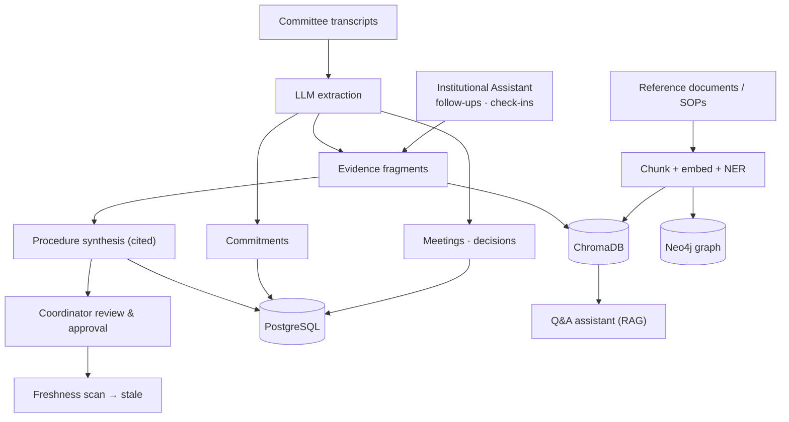

# DJSCE Institutional Brain

**An institutional knowledge and governance platform for Dwarkadas J. Sanghvi College of Engineering (DJSCE).**
It captures what committees, departments and faculty decide and agree to do — from meeting transcripts,
reference documents and a per-member assistant — and turns it into searchable, evidence-backed
institutional knowledge: decisions, tracked commitments, documented procedures, and a knowledge graph.

> ⚠️ **Demonstration data.** Synthetic committee records combined with authentic public college-website
> information, cited by URL and retrieval date. Every meeting, internal document, person and procedure in
> `mock_institutional_data/` and `institution.yaml` is **synthetic** — not an official DJSCE record, decision or
> approved policy. `djsce_public_data/kb/` holds information published on the public website
> (https://www.djsce.ac.in, retrieved 2026-10-13); each file and Q&A cites its source URL (index: `djsce_public_data/sources.csv`,
> crawl rules: `djsce_public_data/README.md`). It is ingested as **public** knowledge for students.

Built on the open-source *Company Brain* architecture and adapted for a college setting.

---

## Repository layout

| Path | Side | Contents |
|---|---|---|
| `backend/`, `frontend/`, `docs/`, `mock_institutional_data/` | Development | Application code, engineering docs, synthetic dataset |
| [`publication/`](publication/) | Publication | Project brief for the guide, IPD report, AVINYA poster, slides, paper, meeting notes |

## 📖 Documentation

| Doc | Purpose |
|---|---|
| **[docs/USAGE.md](docs/USAGE.md)** | Setup, running (Docker or local dev), feature walkthrough, troubleshooting |
| **[docs/ARCHITECTURE.md](docs/ARCHITECTURE.md)** | Codebase map — services, routes, models, jobs, "where to change X" |
| **[docs/CUSTOMIZING.md](docs/CUSTOMIZING.md)** | Institution profile (`institution.yaml`): branding, settings, help desk, people and roles |
| **[docs/CHANGELOG.md](docs/CHANGELOG.md)** | What changed and why |

---

## The problem

Institutional knowledge in a college is scattered across committee minutes, circulars, SOPs, accreditation
working papers and people's memory. Decisions get made in an Academic Council or IQAC meeting, action items
are assigned, and then the trail goes cold. When a procedure (exam moderation, lab readiness, curriculum
review) needs to be followed again, nobody can find *how it was actually done* or *who agreed to what*.

## What it does

| Area | What you get |
|---|---|
| **Meeting intelligence** | Paste a committee transcript → summary, participants, decisions and commitments (with owners and due dates) are extracted. |
| **Commitments** | Every action item is tracked through `open → in_progress → blocked → done / dropped`. |
| **Institutional Assistant (PA)** | Each member gets natural-language follow-ups on their open commitments and a short end-of-day check-in — no forms. |
| **Procedures** | Related evidence is clustered and synthesized into structured procedures (trigger, steps, decision rules, guardrails, escalation), each citing its source excerpts. A coordinator reviews and approves them. |
| **Evidence & provenance** | The Evidence panel groups duplicate excerpts while keeping every underlying citation inspectable. |
| **Knowledge graph** | People and bodies mentioned in documents are linked in Neo4j and visualised. |
| **Q&A assistant** | RAG chat grounded in indexed transcripts and documents; every answer lists its sources. |
| **Help Desk** | Students (and faculty) get instant answers from *public* department information (curriculum, electives, outcomes, placements), or raise a ticket. AI triages it (category, priority, owning office) and drafts a cited reply that a faculty member reviews and sends. |
| **Freshness** | When new evidence contradicts an approved procedure, it is flagged `stale` and routed back for review. |

---

## Architecture



| Layer | Technology |
|---|---|
| Frontend | Next.js 16, React 19, TypeScript, Tailwind CSS v4 |
| Backend API | FastAPI, Python 3.11 |
| Auth | JWT, role-based access: Student < Faculty < Committee Coordinator < System Administrator, enforced in the API; knowledge tagged public/internal |
| Relational store | PostgreSQL (SQLModel) |
| Vector search | ChromaDB + sentence-transformers |
| Graph | Neo4j |
| LLM | Groq (configurable model) |
| Background jobs | Celery + Redis (worker + beat) |
| Deployment | Docker Compose |

---

## Quick start

```bash
cp .env.example .env               # set GROQ_API_KEY and SECRET_KEY
docker compose up -d --build
python ingest_institutional.py     # load the synthetic DJSCE dataset (optional: --approve)
```

Open http://localhost:3000 and use the one-click demo logins (all synthetic,
password `demo123`): System Administrator, Committee Coordinator, Faculty, Student. Full instructions: [docs/USAGE.md](docs/USAGE.md).

---

## API overview

All endpoints except `/health`, `/api/v1/institution` and auth require a Bearer token. 👥 = staff only (faculty and above). 🔒 = `manager` role or higher.

| Method | Path | Description |
|---|---|---|
| `POST` | `/api/v1/auth/login` · `/register` | Obtain a JWT |
| `POST` / `GET` | `/api/v1/transcripts` · `/{id}` | Ingest a transcript (queued) / list and fetch meetings |
| `POST` | `/api/v1/ingest/file` | 👥 Upload a .txt / .pdf / .docx document, `visibility=internal\|public` (queued) |
| `GET` · `PATCH` | `/api/v1/commitments` · `/mine` · `/{id}` | List commitments / update status |
| `GET` · `POST` | `/api/v1/pa/followups` · `/pa/checkin` … | Assistant follow-ups and end-of-day check-in |
| `GET` | `/api/v1/skills` · `/{id}` | List procedures / full procedure with citations |
| `POST` | `/api/v1/skills/extract` | 🔒 Run procedure extraction |
| `PATCH` · `POST` | `/api/v1/skills/{id}` · `/approve` · `/reject` | 🔒 Edit and review procedures |
| `GET` | `/api/v1/skills/{id}/file` | Rendered `SKILL.md` (approved only) |
| `POST` | `/api/v1/chat` | Q&A with sources (students: public knowledge only) |
| `GET` · `POST` | `/api/v1/helpdesk/categories` · `/tickets` · `/tickets/mine` | Help desk: categories, raise and track own tickets |
| `GET` · `POST` | `/api/v1/helpdesk/tickets` (queue) · `/{id}/reply` · `/{id}/retriage` | 👥 Staff queue, AI draft, human reply |
| `GET` | `/api/v1/graph/data` · `/stats` | Knowledge-graph data |
| `GET` · `POST` | `/api/v1/sources` · `/{name}/sync` | Source connectors (sync 🔒) |
| `GET` | `/api/v1/audit` | 🔒 Audit trail |
| `GET` | `/health` | Health check |

Interactive docs: http://localhost:8001/docs

---

## Current scope and limitations

- Meeting capture is transcript-based (no live meeting bot).
- Slack / database connectors are credential-aware stubs; the `manual` connector accepts pushed items.
- Visibility is two-level (public / internal); per-department or per-committee scoping is not implemented yet.
- Help-desk replies are always written or approved by staff; the AI never answers a ticket on its own.
- Committee data is synthetic; public website content is a snapshot (retrieved 2026-10-13) and may go stale.
- Evaluation harness in `evaluation/` (`docker compose --profile eval run --rm evaluator`); results in
  `publication/01_ipd_report/results/`. An optional non-generative **laya** triage engine (`TRIAGE_ENGINES`,
  installed only in the `evaluator` service) was compared; it was less accurate than the LLM in run 1, so the
  default stays `llm,keyword`.

## Tests

```bash
cd backend && python -m pytest -q        # mocks all external services; no Docker needed
cd frontend && npm run lint && npx tsc --noEmit
```

## License

MIT
