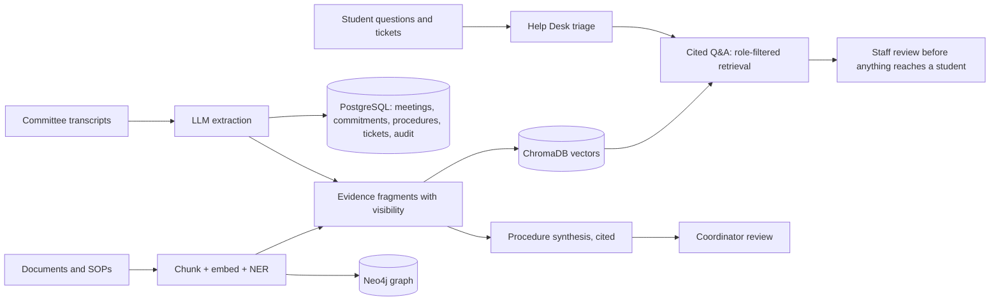

# DJSCE Institutional Brain — Project Brief

*For our project guide. Explains what the project is, why it matters, what is built,
and what comes next. Last updated: 13 Oct 2026.*

| | |
|---|---|
| **Course** | Innovative Product Development (IPD) — multi-semester project |
| **Department** | Computer Engineering, D. J. Sanghvi College of Engineering |
| **Team** | _⟨names and roll numbers⟩_ |
| **Guide** | _⟨guide name⟩_ |
| **Repository** | github.com/Vivan-23/DJSCE-Institutional-Brain (private) |

---

## 1. In one paragraph

A college runs on decisions made in meetings — Academic Council, IQAC, Board of
Studies, exam and lab committees — and on procedures that live in circulars, SOPs and
people's memory. That knowledge is scattered, so action items go untracked, procedures
get re-invented, and students cannot get simple answers without visiting an office.
**DJSCE Institutional Brain** captures this knowledge from meeting transcripts and
documents, uses AI to extract **decisions, commitments (who agreed to do what, by
when) and step-by-step procedures**, sends every AI output through **human review**,
and serves the result back through a **cited Q&A assistant** for staff and a
**Student Help Desk** for students — with **role-based access** so internal
deliberations never reach students.

## 2. The problem

| Who | Pain today |
|---|---|
| Committee coordinators | Minutes are written by hand; action items from a meeting are forgotten by the next one. |
| Faculty | Procedures (exam moderation, lab readiness, curriculum review) are re-learned each cycle; nobody knows the latest version. |
| Students | Simple questions (electives, syllabus, outcomes, placements) need a visit or an email; queries get lost with no tracking. |
| Accreditation (NBA/NAAC) | Evidence for decisions and processes is hard to assemble after the fact. |

Generic chatbots do not solve this: they answer from the open internet, invent policy,
cannot show their sources, and do not know who is allowed to see what.

## 3. What the system does

1. **Meeting intelligence** — paste a committee transcript; the system extracts a
   summary, participants, decisions and **commitments with owners and due dates**
   (natural-language dates such as "by next Monday" are resolved).
2. **Commitment tracking** — every action item moves through *open → in progress →
   blocked → done*. A **Faculty Desk assistant** follows up in plain language and
   runs a short end-of-day check-in instead of a status form.
3. **Procedure synthesis** — related evidence is clustered and turned into a structured
   procedure (trigger, steps, decision rules, guardrails, escalation). **Every step
   cites its source excerpts.** A coordinator approves or rejects it.
4. **Freshness** — when new evidence contradicts an approved procedure, it is flagged
   *stale* and sent back for review instead of being silently trusted.
5. **Cited Q&A assistant** — answers questions using only indexed institutional
   knowledge and lists the excerpts it used.
6. **Student Help Desk** — students get instant answers from *public* department
   information. If that is not enough they raise a **ticket**: AI classifies it,
   sets priority and routes it to the responsible office (Exam Cell, Department
   Office, T&P Cell …) and drafts a cited reply that a **faculty member edits and
   sends**. The AI never replies to a student on its own.
7. **Knowledge graph** — people and bodies mentioned in documents are linked and
   visualised in Neo4j.
8. **Audit trail** — every AI action and every human approval is logged.

## 4. Users and access (enforced in the backend, not just hidden in the UI)

| Role | Sees / does |
|---|---|
| **Student** | Help Desk, own tickets, assistant over **public** knowledge only |
| **Faculty** | Meetings, commitments, Faculty Desk, procedures, graph, documents, ticket queue |
| **Committee Coordinator** | + approve/reject procedures, run extraction, audit log |
| **System Administrator** | everything |

Every piece of indexed knowledge carries a **visibility** label (*internal* or
*public*). For a student, the vector search itself is restricted to public knowledge
and results are re-checked, so a committee transcript cannot leak into a student's answer.

## 5. Architecture

| Layer | Technology |
|---|---|
| Frontend | Next.js 16, React 19, TypeScript, Tailwind CSS |
| Backend | FastAPI (Python 3.11), JWT auth, role-based access |
| Data | PostgreSQL (records), ChromaDB + sentence-transformers (semantic search), Neo4j (graph) |
| AI | Large language model via Groq for extraction, synthesis, triage and answers; spaCy NER; optional laya classifier for triage (compared in evaluation) |
| Jobs | Celery + Redis (background ingestion, daily follow-ups, nightly extraction and freshness scan) |
| Deployment | Docker Compose (8 services); ngrok for remote demos |

## 6. What is new (our contribution)

1. **Evidence-first AI.** Every AI output — answer, procedure, ticket draft — carries
   the source excerpts it came from. Retrieved evidence is kept visually separate from
   the AI's wording.
2. **Human-in-the-loop by design.** Procedures need coordinator approval; ticket replies
   need a faculty member to send them; contradictions route back to review.
3. **Access-aware retrieval.** Visibility is enforced inside vector search, not just in
   the UI — a real requirement for colleges that most RAG demos ignore.
4. **From meetings to accountability.** Commitments are extracted with owners and dates
   and followed up conversationally, closing the loop that minutes leave open.
5. **Constrained AI triage with an offline fallback.** The classifier may only choose
   categories the institution configured; if the LLM is unavailable or invents a label,
   a deterministic keyword classifier takes over (adapted from our earlier student
   chatbot mini-project).

## 7. Current status (honest)

| Area | Status |
|---|---|
| Transcript → decisions/commitments, commitment tracking, Faculty Desk | ✅ working |
| Procedure synthesis with citations, approval, freshness scan | ✅ working |
| Cited Q&A, role-filtered retrieval | ✅ working |
| Student role, Help Desk tickets, AI triage + draft + human reply | ✅ working |
| Knowledge graph, audit log, Docker deployment, remote demo | ✅ working |
| Automated tests | ✅ 235 backend tests; frontend type-check and lint clean |
| Per-department access (CE vs IT), notices, calendar, analytics, user admin | ✅ working |
| Knowledge graph edges (documents, meetings, people, bodies) | ✅ working |
| Evaluation harness (triage incl. laya, Q&A, visibility, departments, commitments) | ✅ final run 19 Oct 2026; run 1 kept as baseline |
| Data | Synthetic committee records + authentic public website information (26 files, URL-cited) |
| Real internal institutional records | ⛔ out of scope: committee data is **synthetic** |

## 8. What we will measure (evaluation plan)

| Question | Method | Metric |
|---|---|---|
| Does triage route tickets correctly? | Labelled set of ~100 synthetic student queries | accuracy / macro-F1 for LLM vs keyword baseline (and optionally a laya classifier) |
| Are answers grounded? | Question set with known source passages | % answers citing the correct source; hallucination rate |
| Does visibility hold? | Adversarial student questions about internal meetings | leaks per 100 queries (target 0) |
| Is it fast enough? | Timed API calls | p50/p95 latency for answers and triage |
| Is extraction useful? | Transcripts with hand-labelled commitments | precision/recall of extracted commitments |

### Results (19 Oct 2026, `openai/gpt-oss-120b`, from `../01_ipd_report/results/RESULTS.md`)

| Measure | Result |
|---|---|
| Ticket triage accuracy, 96 queries: LLM / keyword / laya | 90.6 % / 57.3 % / 51.0 % |
| Q&A, 33 questions: correct source in top 5 | 100 % |
| Q&A: answer correct (run 1: 71 %) | 91 % |
| Internal evidence leaked to students, 20 adversarial queries | 0 |
| Cross-department leaks, 10 queries | 0 |
| Commitment extraction, 9 gold | precision 1.00, recall 1.00 |
| p95 answer latency (target 10 s) | 10.0 s (student answers 7.8 s) |

## 9. Roadmap

1. Per-committee confidentiality.
2. Notice attachments and e-mail delivery; feedback on answers.
3. Pilot with one department on consented real records.
4. NBA/NAAC evidence tracker linking decisions and documents to criteria.
5. Optional: fast non-generative triage classifier (laya) compared against the LLM.

## 10. Five-minute demo script

1. **Student** login → Help Desk → click *"Which electives are offered in Semester VI?"*
   → cited answer from public information.
2. Raise a ticket about re-evaluation → see it routed to the **Examination Cell**.
3. **Faculty** login → Help Desk Queue → AI triage + draft reply with sources → edit → send.
4. Back as student → reply visible under *My tickets*.
5. **Coordinator** login → Meetings → a committee transcript's extracted decisions and
   commitments → Procedures → open one, inspect its evidence → approve.
6. Ask the staff assistant about a council decision → answer with sources.

## 11. Questions a reviewer is likely to ask

- **"Isn't this just ChatGPT on documents?"** No — answers are restricted to indexed
  institutional sources and cite them; outputs pass human review; access is enforced per
  role in the retrieval itself; and the system produces structured records (commitments,
  procedures, tickets), not just chat.
- **"What if the AI is wrong?"** Nothing the AI produces reaches a student or becomes an
  approved procedure without a human; contradicting evidence marks procedures stale.
- **"Is the data real?"** Partly. Meetings, people and internal procedures are synthetic.
  Student-facing public knowledge is authentic information published on the college website
  (https://www.djsce.ac.in), cited by URL and retrieval date (2026-10-13); public pages only, no personal
  contact data. We acknowledge use of public website content.
- **"Can students see committee discussions?"** No — their retrieval only searches
  *public* knowledge, and this is covered by automated tests.
